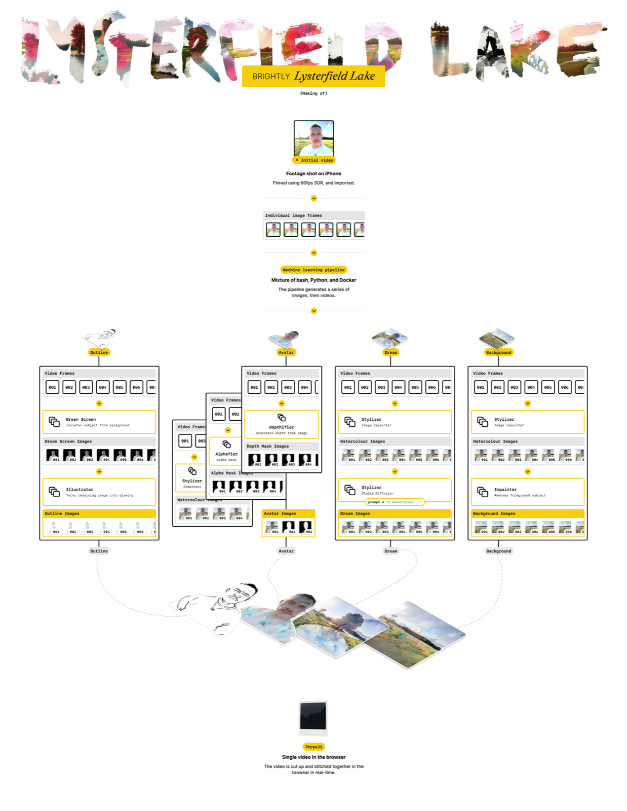

# Lysterfield Lake

An interactive, AI-generated, 3D music video for Brightly's "Lysterfield Lake", made from a single video shot on an iPhone. Watch it at [lysterfieldlake.com](https://lysterfieldlake.com/).

This repo holds the whole project: the app that plays the video, the pipeline that makes it, and the models the pipeline runs. It replaces two older repos, [lysterfield-lake-client](https://github.com/superhighfives/lysterfield-lake-client) (the original app) and [lysterfield-lake-pipeline](https://github.com/superhighfives/lysterfield-lake-pipeline) (the original bash and Python pipeline). Both are still there to read, but nothing new happens in them.

This is a passion project. It's here for anyone who wants to see how the video was made, not as an example of how to build a fast React app.

You can [read more about how the project works on Medium](https://medium.com/@superhighfives/lysterfield-lake-71345aa8c016).

<a href="https://medium.com/@superhighfives/lysterfield-lake-71345aa8c016">
  <picture>
    <source media="(prefers-color-scheme: dark)" srcset=".github/readme/making-of-dark.png">
    
  </picture>
</a>

## How it works

The video is seven panels of the same footage, each one a different take on it:

1. Lyrics
2. Portrait: the person, repainted
3. Portrait background: the scene with the person removed
4. Matte: a cut-out mask of the person
5. Depth: how far each part of the frame is from the camera
6. Outline: line art of the person
7. Dream: the whole scene reimagined as a painting, with no person in it

The app plays panels 1 to 6 as one shared video with the song, and each dream as a small video of its own beside it. In the browser, [three.js](https://threejs.org/) cuts the panels apart and puts them back together as a 3D scene. You steer it with the mouse, or by tilting your phone. You can switch dreams mid-song from the stack of cards, and the music keeps playing.

There are eleven dreams so far, from "Watercolour" to "Sharp Edges".

## What's in here

| Directory | What it is |
| --- | --- |
| `apps/client` | The app: Vite, React and React Three Fiber, served by a Cloudflare Worker at lysterfieldlake.com |
| `apps/pipeline` | A command-line tool that turns one video into every panel, mostly by calling models on [Replicate](https://replicate.com/) |
| `models` | The project's own [Cog](https://github.com/replicate/cog) models, and a local person check for the dreams |
| `plans` | Plans for the work, moved through `backlog`, `ready`, `in-progress` and `done` |

### The pipeline

The original pipeline was a set of bash scripts that ran Python scripts, ffmpeg, and three model servers on a PC with an RTX 3060. Making a dream meant a manual pass through Deforum and frame interpolation on that same PC.

The new one is a single TypeScript command-line tool. Each panel is a step you can run on its own against a job folder (`apps/pipeline/.jobs/<name>/`), and a step skips any output that already exists, because model calls cost money and a song is thousands of frames. The models behind each panel:

| Panel | Model |
| --- | --- |
| Portrait | [DiffusionCLIP](https://github.com/gwang-kim/DiffusionCLIP), as the project's own Cog model (`models/diffusionclip`), upscaled with [Real-ESRGAN](https://replicate.com/cjwbw/real-esrgan) |
| Portrait background | [Bria's video object eraser](https://replicate.com/bria/video-erase-object) |
| Matte | [Robust Video Matting](https://replicate.com/arielreplicate/robust_video_matting) |
| Depth | [ZoeDepth](https://replicate.com/cjwbw/zoedepth) |
| Outline | Coarse line art from ControlNet's annotators (`models/lineart`) |
| Dream | Deforum 0.7.1, set up the way the original dreams were made (`models/deforum`), with an optional style reference image |

Dreams run on Replicate, or on a local RTX 4090 for free. Every dream frame then gets a person check (`models/person-check`, a local CLIP model), because the dream panel must never show a person. Flagged stretches are rendered again with new seeds instead of being blended over.

A development-only `/admin` page in the app drives all of this: brainstorm a dream's direction, judge it on a few sample frames, then on a 15-second clip in the real player, and only then pay for the full song.

## Coming soon

- **Polaroids.** An "Add your own" link under the dream stack opens an endless grid of looping 3D polaroids, one per visitor. You record a 5-second clip, it waits in a queue until a person approves it, and then the pipeline turns it into a polaroid of you, made from panels 2 to 6. You get an email with a private link when it's ready. It works end to end in `/admin` today, behind the `VITE_APP_POLAROIDS` flag.
- **More dreams.** The person check and repair loop make a new dream much cheaper to check, so the next one is on its way.
- **Cleaner dreams.** Repairing the frames in the ten original dreams where a person leaks through, and trying video models like Wan VACE that hold together better from frame to frame than Deforum.
- **Steadier mattes and depth.** The matte sometimes glitches for a second or two, and depth can flutter in the corners. Newer models may fix both.

## Getting started

You need [Bun](https://bun.sh/). Install everything from the root:

```sh
bun install
```

Run the app:

```sh
bun run --cwd apps/client dev
```

The videos aren't in the repo. The app reads them from `VITE_APP_DREAMS`: in development, the gitignored `apps/client/dreams/<id>/` folder, which the pipeline's `compose` and `compose-split` steps write to.

Run a pipeline step (it needs `REPLICATE_API_TOKEN` in `apps/pipeline/.env`; see `apps/pipeline/.env.example`):

```sh
bun run --cwd apps/pipeline cli init --job .jobs/my-video --source ~/Movies/my-video.mov
bun run --cwd apps/pipeline cli matte --job .jobs/my-video
```

Merging to `main` deploys the app (`.github/workflows/deploy-next.yml`).
